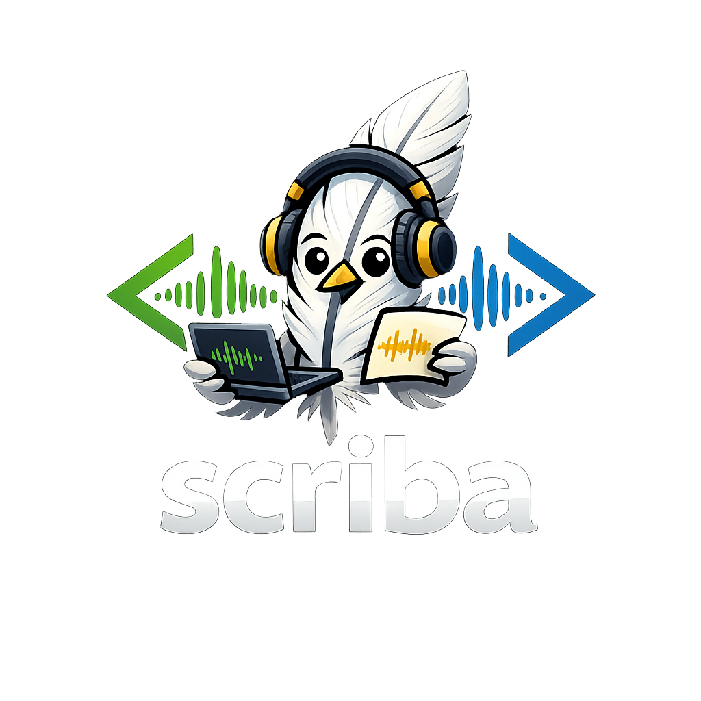
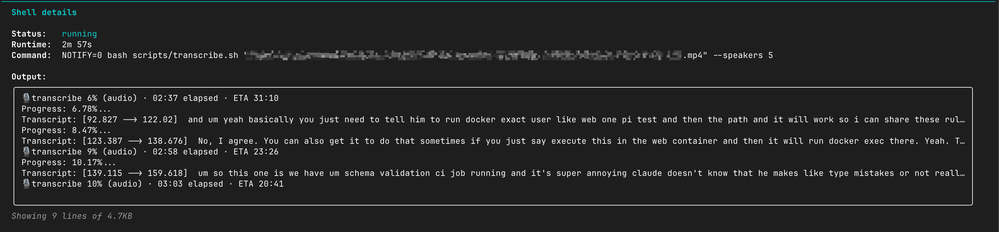

<p align="center">
  
</p>

<h1 align="center">scriba</h1>

<p align="center">
  <b>Transcripción gratuita, local y precisa de reuniones con reconocimiento de hablantes — para tu asistente de IA o segunda mente.</b><br>
  Copia la ruta de un archivo en el chat de tu agente de IA — o ejecuta un comando en tu terminal — y obtén una transcripción limpia con etiquetas de hablantes. Funciona con <a href="https://docs.claude.com/en/docs/claude-code/overview">Claude Code</a>, Codex, Cursor, Aider &amp; otros mediante <a href="./AGENTS.md"><code>AGENTS.md</code></a>, o como una CLI simple sin IA alguna. Todo se ejecuta en tu Mac: sin nube, sin cargas, sin suscripción.
</p>

<p align="center">
  <a href="https://github.com/AlexanderAbramovPav/scriba/actions/workflows/ci.yml"></a>
  <a href="https://github.com/AlexanderAbramovPav/scriba/stargazers"></a>
  <a href="./LICENSE"></a>
  
  
  
  <a href="./AGENTS.md"></a>
</p>

## Contenido
- [Por qué](#why)
- [Comparación](#how-this-compares)
- [Qué obtendrás](#what-youll-get)
- [Instalación](#install)
- [Uso](#usage)
- [Limitaciones](#limitations)
- [Avanzado — para usuarios experimentados](#advanced--for-power-users)
- [Licencia](#license) · [Agradecimientos](#acknowledgments)

## Por qué

- **Tu audio nunca sale de tu computadora.** No se carga nada en ninguna nube — ni Otter, ni AssemblyAI, ni OpenAI, ni nosotros. La transcripción y el reconocimiento de hablantes se ejecutan localmente en tu Mac (o servidor Linux).
- **Funciona con cualquier cosa.** Grabaciones de Zoom, memos de voz, archivos de podcast, exportaciones de llamadas telefónicas — `.mp4`, `.mov`, `.m4a`, `.mp3`, `.wav`, `.webm`, lo que sea. El skill se encarga de la conversión de formato por ti.
- **Reconocimiento preciso de hablantes — y honesto al respecto.** "Quién dijo qué" se ejecuta con `speaker-diarization-community-1` de [pyannote](https://github.com/pyannote/pyannote-audio), uno de los modelos de diarización *open-source* más precisos (sus autores [reportan](https://huggingface.co/pyannote/speaker-diarization-community-1) ~10–11% DER en benchmarks estándar), seleccionado para que funcione en una **Mac normal (M3 / 16 GB)**, no solo en un M-Max de gama alta. Un modelo más pesado (DiariZen-WavLM) lo supera en algunos benchmarks en inglés pero consume mucho más potencia de cómputo; scriba prioriza el equilibrio entre precisión y huella de recursos. Las palabras provienen de [OpenAI Whisper large-v3](https://github.com/openai/whisper). **No te fíes de nuestra palabra — [métrelo con tu propio audio](./benchmarks/)** usando `scripts/benchmark_der.py`.
- **Puedes verlo funcionar en tiempo real.** Progreso en vivo en la barra de estado de tu editor, en una terminal lateral, o como una notificación de macOS cuando termina — elige lo que prefieras. Sin más pantallas negras preguntándote si se quedó pegado.
- **Solo un comando.** Sin pasos de configuración que aprender. El asistente te guía por cualquier cosa que aún no tengas (cuenta de HuggingFace, etc.) en lenguaje claro.
- **Diseñado para ejecutarse automáticamente.** Apunta un observador `launchd`/`cron` a tu carpeta de grabaciones de Zoom o Meet — cada llamada se convierte en una transcripción indexable que fluye hacia tu **segunda mente / base de conocimiento personal de IA** (Obsidian, Notion, Cognee, mem0, lo que uses). Cuantas más conversaciones capture y alimente a tu asistente, más precisos serán sus respuestas sobre *ti*. Consulta [Karpathy sobre wikis personales](https://x.com/karpathy/status/1655994367033524225) para la idea general.

## Comparación

|                                       | scriba | Otter / Fireflies / Granola | Local Whisper solo |
| ------------------------------------- | :----------------: | :-------------------------: | :-----------------: |
| El audio permanece en tu computadora          |        ✅          |             ❌              |         ✅          |
| Indica quién dijo qué                                  |        ✅          |             ✅              |         ❌          |
| Indica quién dijo qué — *y qué tan seguro está*           |        ✅          |             ❌              |         ❌          |
| Costo tras la instalación                    |      **$0**        |        $10–30/mo            |         $0          |
| Funciona sin conexión                         |        ✅          |             ❌              |         ✅          |

*"…y qué tan seguro está"*: cada palabra en el archivo JSON adjunto incluye una confianza de ASR, una confianza de atribución de hablante y un indicador de superposición, para que tu IA sepa qué líneas confiar y cuáles tratar como inciertas. Y puedes cuantificar la diarización en sí: [`benchmarks/`](./benchmarks/) incluye un evaluador DER en Python puro que puedes ejecutar con tu propio audio etiquetado.

## Qué obtendrás

Una carpeta portátil `<title>.transcript/` junto a tu video de entrada, que contiene el Markdown y sus recursos, con **un clip de voz de 10 segundos por hablante** incrustado directamente en el archivo (haz clic en ▶ para reproducir en Obsidian / VS Code / GitHub):

```markdown
# q3-planning-sync

## Speakers — identify who's who

**Speaker 1** (80% of speaking time).
<audio controls src="data/speaker-1.wav"></audio>

Sample utterances:
> [00:00:03] «So the launch is moved to Friday — can we ship the docs by Thursday?»
> [00:00:40] «...»

**Speaker 2** (18% of speaking time).
<audio controls src="data/speaker-2.wav"></audio>
...
```

Luego, el asistente te pregunta "¿quién es el Hablante 1?"; respondes y renombra al hablante en todas partes de la transcripción.

## Instalación

```bash
git clone https://github.com/AlexanderAbramovPav/scriba ~/.claude/skills/scriba
```

Listo. **No configures nada con antelación.** La primera vez que transcribas, el asistente se pausará y te guiará en un paso único de ~30 segundos: crear una cuenta gratuita de HuggingFace y pegar un token de nuevo en el chat. Tres clics en un navegador, sin comandos de terminal. No volverás a verlo después de eso.

> *¿Por qué HuggingFace?* Es el equivalente open-source a una tienda de aplicaciones para modelos de IA. El modelo de reconocimiento de hablantes es gratuito, pero sus autores requieren aceptar un acuerdo de uso una vez — bastante estándar para open-source de grado investigador.

### ¿No usas Claude Code? Úsalo con cualquier otra herramienta

El núcleo de `scriba` es una tubería (pipeline) de bash + Python. La capa de "skill" es un envoltorio delgado que ayuda a un agente de IA a guiarte en la configuración y el nombrado de hablantes — y hay una versión agnóstica de esas instrucciones en [`AGENTS.md`](./AGENTS.md), soportada por la mayoría de las herramientas modernas de codificación con IA.

| Tu herramienta                       | Dónde apuntarla                                                            | Cómo invocarlo                            |
| ------------------------------- | ---------------------------------------------------------------------------- | ---------------------------------------- |
| **Claude Code**                 | clonar en `~/.claude/skills/scriba/` *(comando de instalación predeterminado arriba)*       | `/scriba <archivo>`                         |
| **OpenAI Codex CLI**            | clonar en cualquier lugar, colocar `AGENTS.md` en `~/.codex/AGENTS.md` *(o raíz del proyecto)* | "transcribe esta reunión: `<archivo>`"      |
| **Cursor**                      | clonar en cualquier lugar, copiar `AGENTS.md` a `.cursor/rules/scriba.md`                 | mencionar `@scriba` o lenguaje natural     |
| **Continue.dev**                | clonar en cualquier lugar, registrar `transcribe.sh` como comando slash personalizado en `~/.continue/config.yaml` | `/scriba <archivo>` |
| **Aider**                       | clonar en cualquier lugar, `aider --read <scriba>/AGENTS.md <archivo>`                     | lenguaje natural en el chat                  |
| **Goose** (Block)               | clonar en cualquier lugar, agregar como extensión de comando shell                             | mencionar scriba en el chat                   |
| **ChatGPT / Claude.ai navegador** | abrir `AGENTS.md`, pegar en "Instrucciones personalizadas" o slot de contexto del proyecto | indicar al chat la ruta del archivo local        |
| **Sin IA alguna**                | clonar en cualquier lugar                                                                | `bash <scriba>/scripts/transcribe.sh <archivo>` |

`AGENTS.md` se está convirtiendo en un estándar de facto para instrucciones de agentes de IA entre herramientas — mismo rol que `SKILL.md` pero neutro al proveedor. La CLI de bash funciona en cualquier entorno, con o sin un agente de IA dirigiéndola.

## Uso

La ruta más fácil es Claude Code (otros agentes y la CLI simple: ver [Úsalo con cualquier otra herramienta](#dont-use-claude-code-use-it-with-anything-else) arriba). Abre Claude Code, escribe:

```
/scriba /ruta/a/tu-reunion.mp4
```

Ahora puedes irte. El asistente ejecuta la transcripción en segundo plano. Mientras trabaja:

- **Estado en vivo** es visible inline en la barra de estado de tu chat (algo como `🎙 tx 47% · ETA 01:18`), actualizado cada pocos segundos.
- **Una notificación de macOS** aparece cuando termina (sonido Glass).
- O abre una terminal lateral y ejecuta el mismo comando con `--watch` para una vista de progreso a pantalla completa.

<p align="center">
  
</p>
<p align="center"><sub>El progreso en vivo se transmite directamente a los "Shell details" de Claude Code — la etapa actual, % y ETA se actualizan a medida que se ejecuta (incluso mientras la diarización está en silencio).</sub></p>

Cuando termina, el asistente abre el resultado y te muestra los hablantes que encontró. Para cada uno obtienes:
- Un **clip de voz corto** (~10 segundos, haz clic en reproducir en el chat / tu editor — `<audio>` está incrustado directamente en el Markdown).
- **Tres frases de ejemplo** con marcas de tiempo.

El asistente pregunta "¿quién es quién?" — respondes (ej. "El Hablante 1 es Alice, el Hablante 2 es Bob") — los renombra en todas partes de la transcripción. Hecho.

## Ubicación de archivos

Cada grabación se convierte en una carpeta portátil y autónoma junto a tu archivo de entrada:

```
tu-reunion.transcript/      ← mueve/comprime/sincroniza toda esta carpeta; nada se rompe
├── tu-reunion.md           ← la transcripción (título H1 + frontmatter)
└── data/
    ├── transcript.json       ← archivo adjunto legible por máquina enriquecido (confianza por palabra, hablantes)
    └── speaker-1.wav …       ← un clip de voz ≤10 s por hablante, incrustado en el MD
```

El MD apunta a `data/…` con rutas **relativas**, por lo que la carpeta viaja como una unidad — abre `tu-reunion.md` en cualquier visor de Markdown (Obsidian, VS Code, GitHub) y los reproductores `<audio>` incrustados simplemente funcionan.

El **nombre de la carpeta/archivo es significativo**: se deriva del nombre de tu video (kebab-cased). Cuando el nombre de origen es genérico (`zoom_0`, `GMT20260605-120000`, `recording`, …), el asistente elige un título real por ti. El nombre de archivo original siempre se preserva en el campo `source:` del frontmatter.

Junto a tus grabaciones, una carpeta oculta **`.scriba/`** contiene el estado global del corpus que tu IA usa para navegar todo: `index.json` (una entrada por grabación — leída una vez, encuentra cualquier reunión), más el glosario y las huellas de voz persistentes. Layout completo en [`references/file-layout.md`](./references/file-layout.md).

## Más allá de reuniones aisladas — ejecútalo automáticamente

El flujo de comando slash es la ruta fácil. Si quieres que cada conversación se capture automáticamente, apunta un pequeño observador a la carpeta donde tu herramienta de reuniones deposita las grabaciones:

```bash
# Observar ~/Documents/Zoom/, transcribir nuevos archivos .m4a o .mp4
fswatch -0 ~/Documents/Zoom | while read -d '' f; do
  case "$f" in *.m4a|*.mp4)
    bash ~/.claude/skills/scriba/scripts/transcribe.sh "$f" ;;
  esac
done
```

Luego apunta tu herramienta de segunda mente (Obsidian, Cognee, mem0, Notion AI, …) a los archivos `*.transcript/*.md` y tendrás un corpus personal, privado e indexable de todo lo que se ha dicho en tus reuniones — alimentando de vuelta a los asistentes de IA como [Karpathy describió una wiki personal](https://x.com/karpathy/status/1655994367033524225). Cuantas más conversaciones pueda alcanzar el asistente, más sonará como *tú* y mejor responderá preguntas sobre *tu* mundo.

## Limitaciones

- Dos hablantes con voces similares (ej. hermanos, o dos voces suaves) pueden fusionarse en uno.
- La música de fondo intensa o tres o más personas hablando simultáneamente degradan los límites de los hablantes.
- Apple Silicon altamente recomendado. Las Mac con Intel funcionan pero son ~3× más lentas; Linux funciona (sin notificación de macOS, sin modo rápido MLX).
- La primera ejecución descarga ~3 GB de modelos; planifica en consecuencia si tienes conexión meditada.
- Los idiomas distintos al inglés y ruso se detectan y transcriben automáticamente, pero la calidad del reconocimiento de hablantes no ha sido evaluada específicamente por idioma.

---

## Avanzado — para usuarios experimentados

Todo lo siguiente es opcional. El flujo de comando slash arriba es lo que el 99% de las personas necesita.

### Ejecutar el bash directamente

```bash
bash scripts/transcribe.sh <archivo-media> [--fast] [--speakers N] [--lang XX] [--model M]
```

| Bandera | Significado |
|---|---|
| (predeterminado) | Modo precisión — whisperX large-v3 en CPU + diarización pyannote. Progreso real por paso para la diarización. |
| `--fast` | Transcripción con MLX (GPU Apple). Más rápido pero límites de hablantes más gruesos; sin progreso por paso de diarización en esta ruta. |
| `--speakers N` | Indicar el número de hablantes (ayuda a pyannote cuando el audio es corto o ruidoso). Predeterminado: auto. |
| `--lang XX` | Forzar código de idioma ISO (`en`, `ru`, `de`, …). Predeterminado: auto-detectar. |
| `--model M` | Anular el modelo whisper. Predeterminado: `large-v3`. |
| `--bootstrap` | Solo crear el venv, no transcribir. |
| `--status <archivo>` | Imprimir un resumen de progreso de una línea (barato de consultar). |
| `--watch <archivo>` | Observador TUI a pantalla completa (ejecutar en una terminal lateral). |

Renombrado de hablantes a posteriori:
```bash
python3 scripts/rename_speakers.py reunion.transcript/reunion.md "Alice,Bob,Carol"
# o mapeo explícito:
python3 scripts/rename_speakers.py reunion.transcript/reunion.md --map "Hablante 1=Alice,Hablante 2=Bob"
```

### Superficies de monitoreo

Elige el canal que se adapte a tu flujo de trabajo. Todos leen la misma fuente de verdad (`*.transcript.progress.json` junto a la entrada — auto-eliminado al completarse correctamente junto con `*.transcript.log`, para que solo te quedes con la carpeta `<title>.transcript/` orientada a humanos. Los archivos diagnósticos se conservan solo cuando algo falla).

| Superficie | Qué haces | Qué ves |
|---|---|---|
| **Integración de statusline** | Conectar `scripts/statusline.sh` a tu barra de estado de Claude Code / tmux / Starship / p10k una vez. Recetas: [`references/statusline-integration.md`](./references/statusline-integration.md). | `🎙 tx 47%* · ETA 01:18` → `🎙 dia/embedd 50%* · 02:17` → vacío. Se refresca cada ~3 s en tu barra de estado normal. Cero tokens de IA. |
| **TUI `--watch`** | `bash scripts/transcribe.sh --watch /ruta/a/archivo.mp4` en una terminal lateral. | Barra de progreso a pantalla completa, % de audio, ETA, última línea del log. Refresco de 2 s. Ctrl-C desliga; la transcripción sigue ejecutándose. |
| **One-liner `--status`** | `bash scripts/transcribe.sh --status /ruta/a/archivo.mp4` | Una línea: `stage=transcribe · elapsed 02:30 · ETA 01:18 (observed) · audio 47% (measured) · wall 51% · …` |
| **`*.transcript.progress.json`** | Leer el archivo directamente. | JSON compacto (~350 B) con el esquema canónico (ver [`references/eta-factors.md`](./references/eta-factors.md)). Se refresca cada 5 s. |
| **Notificación de macOS** | Nada — se dispara automáticamente al `done` si `osascript` está disponible. | Tarjeta del Centro de Notificaciones "scriba · <archivo> · <reloj de pared>" con el sonido Glass. |
| **`*.transcript.log`** | `tail -f /ruta/a/archivo.transcript.log` | Salida cruda de whisperX + pyannote, incluyendo cada línea `Transcript: [start --> end] text` por segmento y cada evento de progreso `diarize/<step> N% (X/Y)`. |

### Rendimiento — ¿cuánto tardará?

**Regla general: una grabación de 1 hora toma aproximadamente 1 hora en un M4 Max, ~1.5 h en un M2 Max, ~2 h en un M1.** La primera ejecución es más lenta (~5 min de descarga única de modelos); después, el skill se auto-calibra a la velocidad real de tu máquina y el siguiente ETA se ancla a *tu* tasa medida.

El modelo: `wall_clock ≈ audio_sec × factor + warmup`, donde **`factor`** es la relación de tiempo de pared por segundo de audio para la tubería completa (transcribir + alinear + diarizar). Ancorado a una ejecución observada en M4 Max = 1.0× (Jun 2026, `batch_size=1`, `int8` compute_type). Otros chips escalados desde benchmarks públicos de CPU — solo estimaciones iniciales; la caché de calibración en `~/.config/scriba/calibration.json` reemplaza el valor con la tasa observada real después de la primera ejecución ≥60 s.

| Chip | `factor` | Tiempo de pared aproximado para 1 h de audio |
|---|---:|---:|
| M1 | 2.0× | ~2 h |
| M1 Pro | 1.7× | ~1.7 h |
| M1 Max | 1.5× | ~1.5 h |
| M1 Ultra | 1.3× | ~1.3 h |
| M2 | 1.7× | ~1.7 h |
| M2 Pro | 1.5× | ~1.5 h |
| M2 Max | 1.3× | ~1.3 h |
| M2 Ultra | 1.2× | ~1.2 h |
| M3 | 1.5× | ~1.5 h |
| M3 Pro | 1.3× | ~1.3 h |
| M3 Max | 1.2× | ~1.2 h |
| M4 | 1.3× | ~1.3 h |
| M4 Pro | 1.1× | ~1.1 h |
| **M4 Max** | **1.0×** | **~1 h** ← ancla |
| `--fast` (MLX, cualquier Apple Silicon) | ~0.5× | ~30 m |

Intel y CPUs desconocidos caen a `2.0×`. Linux funciona (degradado: sin notificación de macOS, sin MLX nativo) — se aplica la misma tabla de factores, la caché corrige después de la primera ejecución.

**¿Tienes un chip que no está en esta tabla, o una tasa mediblemente diferente?** Consulta [`CONTRIBUTING.md`](./CONTRIBUTING.md) — agregar una fila es un PR de una línea.

### Cómo funciona

1. `transcribe.sh` extrae la entrada a WAV mono de 16 kHz vía ffmpeg.
2. `transcribe_whisperx.py` llama a whisperX con `verbose=True`, que imprime `Transcript: [start --> end] text` por segmento a medida que se decodifica.
3. El envoltorio evita `DiarizationPipeline` de whisperX y llama a `pyannote.audio.Pipeline` directamente con un `TextProgressHook` personalizado para que cada sub-paso de pyannote (`segmentation`, `embeddings`, `clustering`, `speaker_counting`, `discrete_diarization`) reporte sus contadores reales `completed/total` como texto plano.
4. Un temporizador bash escanea el log cada 5 s y escribe el `*.progress.json` canónico.
5. Todas las superficies de monitoreo leen ese JSON.
6. Al salir, `json_to_md.py` convierte el JSON a Markdown dentro de `<title>.transcript/`, ffmpeg corta un clip WAV ≤10 s por hablante en su carpeta `data/` para los reproductores `<audio>` incrustados, el archivo JSON adjunto se copia allí también, y `update_index.py` inserta/actualiza la grabación en `.scriba/index.json`. Ver [`references/file-layout.md`](./references/file-layout.md).

## Licencia

[MIT](./LICENSE) — © 2026 [Alexander Abramov](https://github.com/AlexanderAbramovPav).
Código fuente e incidencias: <https://github.com/AlexanderAbramovPav/scriba>

Dependencias de tiempo de ejecución (whisperX, pyannote.audio, faster-whisper, CTranslate2, OpenAI Whisper, ffmpeg) se instalan localmente, no se venden. Sus licencias están catalogadas en [`THIRD_PARTY_LICENSES.md`](./THIRD_PARTY_LICENSES.md).

**Un modelo tiene una cláusula de atribución**: la tubería de diarización predeterminada `pyannote/speaker-diarization-community-1` es [CC-BY-4.0](https://creativecommons.org/licenses/by/4.0/). Si redistribuyes salidas producidas con este skill, incluye una atribución breve:

> Diarización de hablantes impulsada por [pyannote/speaker-diarization-community-1](https://huggingface.co/pyannote/speaker-diarization-community-1) de Hervé Bredin / pyannoteAI, licenciado bajo CC-BY-4.0.

## Agradecimientos

Este skill es pegamento alrededor de cuatro excelentes proyectos OSS:

- [**whisperX**](https://github.com/m-bain/whisperX) — Max Bain et al. — alineación a nivel de palabra + orquestación de diarización sobre faster-whisper.
- [**pyannote.audio**](https://github.com/pyannote/pyannote-audio) — Hervé Bredin et al. — diarización neural de hablantes.
- [**faster-whisper**](https://github.com/SYSTRAN/faster-whisper) — SYSTRAN — el motor ASR real, respaldado por CTranslate2.
- [**OpenAI Whisper**](https://github.com/openai/whisper) — OpenAI — el modelo acústico.

Y sobre [`uv`](https://github.com/astral-sh/uv) (Astral) para el arranque, y [`ffmpeg`](https://ffmpeg.org/) para todo lo relacionado con audio.
